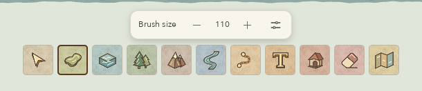

## Overview

Paper UI is Elmapa’s preview appearance. Think of small printed swatches laid out on a cartographer’s worktable. Muted pigment and fine paper grain give the controls a hand-printed feel. Crisp illustrations make them easy to scan while drawing. The artwork on the atlas carries the strongest detail.

The toolbar is the visual reference for this direction. Enable **Paper UI (Preview)** in **Settings** to see it in the editor. The setting defaults to Off and works with both Light and Dark appearance.

## Colors

Use quiet, pale pigments on the faces of controls. In the toolbar, sage identifies Forest, sea glass identifies Water, and rose identifies Eraser. Apply color to a whole control face and let the illustration communicate its purpose as well. When a menu introduces a new role, start with the existing pigments and give the role a consistent hue.

Use selection ink for the active outline. Give a hovered tile a slight lift in brightness and leave enough contrast for a clear active state. On larger panels, give paper colors a quieter role so text, icons, and selection stay easy to read.

## Typography

Use Avenir Next for concise control labels, values, and instructions. Let the illustrated icon lead in compact tool rows and use a tooltip to name its action. Give menus visible text whenever choices need to be read or compared. Use the editor’s Baskerville for titles when a panel needs a heading.

## Layout

The toolbar is a row of individual square controls. The atlas shows in the spaces between them. Keep the row steady when the active tool changes. Put controls for the current tool in a compact strip above the row, where the relationship is easy to see.

For upcoming menus, carry over the spacing, icon treatment, and contained grain from the toolbar. Give related options a shared, quiet surface when that makes the group easier to scan.

## Elevation & Depth

Use the fine, stationary [paper grain](assets/tool-icons/paper.png) as a face texture. Keep it inside the control edges and subtle enough for the icon to read at its normal size. Use minimal depth for individual controls. A soft offset shadow is appropriate for a floating menu where it helps distinguish the menu from the atlas.

## Shapes

Use near-square corners and thin borders. The selected tool gets a two-pixel ink outline that follows selection and snaps into place with Reduced motion.

## Components

### Paper toolbar

The implemented reference is the [Paper toolbar component](src/app/ui/editor/toolbar/paper.rs). It pairs the [illustrated tool symbols](assets/tool-icons/symbols.svg) with tinted paper faces. The [shared toolbar](src/app/ui/editor/toolbar.rs) defines the tool order, labels, actions, and selection for both appearances.

Use this component as the starting point for the brush and placement pickers, followed by the map menu and Layers panel. Apply the same principles to dialogs and the atlas shelf as those surfaces adopt the preview. Check the composition over real atlas artwork in both Light and Dark.
