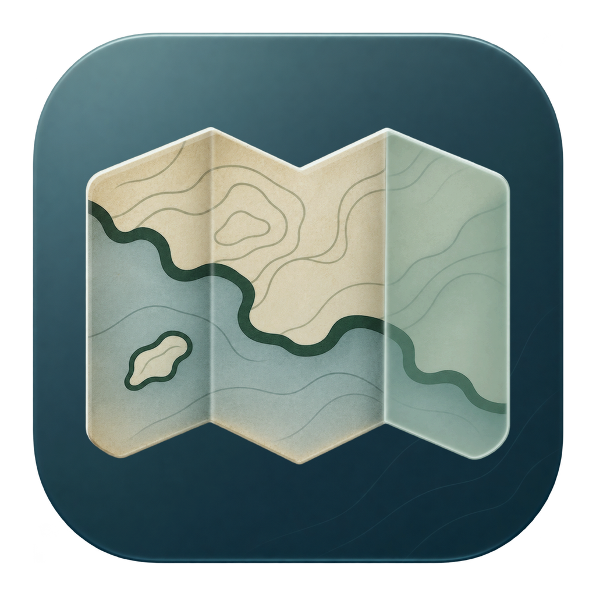
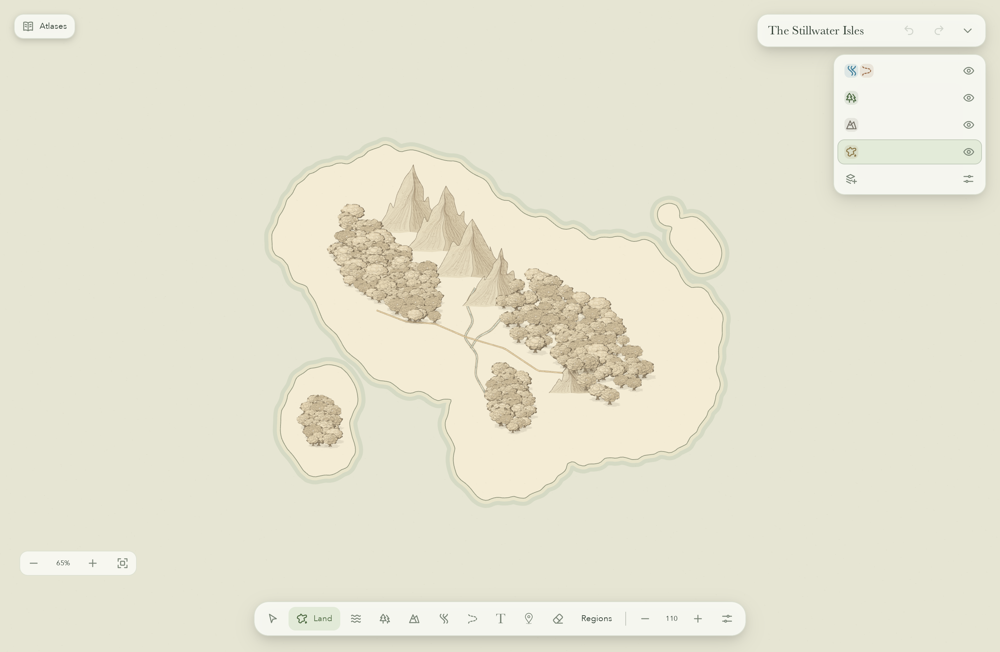
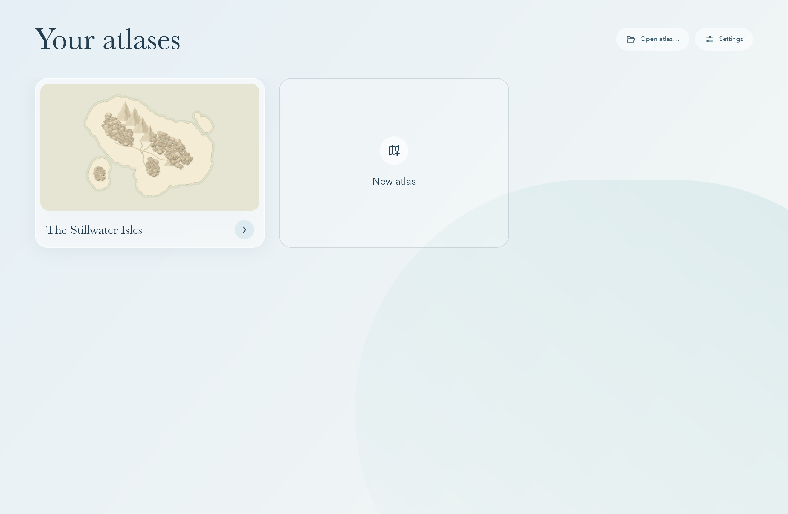

<p align="center">
  
</p>

<h1 align="center">Elmapa</h1>

[](https://github.com/hmrguez/elmapa-public/actions/workflows/ci.yml)

Elmapa is a native map editor for drawing parchment atlases. Paint a coastline, trace a river from the mountains to the sea, and place settlements along its banks. The layered `.elmapa` file stays editable, and SVG export gives you a self-contained map for printing or sharing.



## Get started

Visit [Releases](https://github.com/hmrguez/elmapa-public/releases) for available downloads. Stable builds follow `main`. Builds from `dev` are marked as prereleases. Elmapa targets macOS, Linux and Windows. The native editor workflows documented here have been exercised on macOS. See the [release guide](docs/releases.md) for package formats and channels.

To run from source, install Rust 1.95 or newer and the [native prerequisites for your platform](CONTRIBUTING.md#build-prerequisites).

```sh
git clone https://github.com/hmrguez/elmapa-public.git
cd elmapa-public
cargo run --release --locked
```

Open **España · Pinceladas** on a new shelf, or choose **Example world** in the editor menu to open a fresh copy. In the example, choose **Replay this view** to watch Iberia, the Canaries and the Balearics take shape. Choose **New atlas** to start with blank parchment. Drag the Land brush to paint, scroll to zoom, and drag the middle mouse button to pan. Use the map menu to save an editable file or export SVG.



## Mapmaking

- Shape islands and bays by painting land over water or water over land. Add forests, mountain ridges, rivers and trails, each with its own marks and brush settings.
- Place landmark illustrations, curve place names, and draw regions with shared borders. Layers control visibility, opacity and drawing order.
- Keep atlases in a local shelf with thumbnails. Returning to the shelf or quitting saves a local snapshot. Use **Save** to update an external atlas file.
- Create, inspect, edit, preview and export maps from a local MCP client. See the [MCP guide](docs/mcp.md).

The [user guide](docs/user-guide.md) covers shortcuts, brush materials, region editing and the document format. For custom artwork, see the [landmark pack guide](assets/landmarks/README.md) and [brush material guide](assets/brush-materials/README.md).

## Contributing

New contributors can start with a brush finish, a landmark specimen, a small editor fix or a documentation correction. The [contributor guide](CONTRIBUTING.md) walks through a first change and native verification. The [architecture guide](docs/architecture.md) describes how an edit reaches the saved document, canvas and SVG.

For bugs and feature proposals, [open an issue](https://github.com/hmrguez/elmapa-public/issues/new/choose). For sensitive reports, see the [security policy](SECURITY.md). Our [code of conduct](CODE_OF_CONDUCT.md) applies to participation.

## Validation

With Rust 1.95 or newer, run `cargo test --locked --no-default-features --lib` for a quick check of document editing, map geometry, SVG export, and storage. Append `editor::tests` to run just the undo and editing tests. Desktop and MCP changes use the full suite below.

Run these checks from the project root with Python 3, Rust, Clippy and rustfmt installed. On Windows, use a writable path such as `elmapa-demo.svg` for the final command.

```sh
python3 scripts/export-icons.py --check
python3 -B scripts/test_performance_trace.py
cargo fmt --all -- --check
cargo test --locked
cargo clippy --locked --all-targets -- -D warnings
cargo run --locked --bin elmapa -- --export-demo /tmp/elmapa-demo.svg
```

Cargo accepts `--offline` after dependencies have been downloaded. For interactive performance work, run the optimized build and follow the [native measurement protocol](docs/performance-runtime.md).

## License and artwork

Elmapa is available under the [MIT License](LICENSE). The [third-party notices](THIRD_PARTY_NOTICES.md) cover bundled artwork and dependencies. The [brush artwork credits](assets/brush-materials/README.md) identify third-party CC0 textures. The interface icons have their own [MIT notice](assets/icons/LICENSE).
